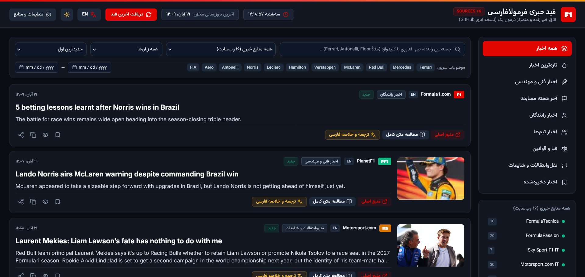
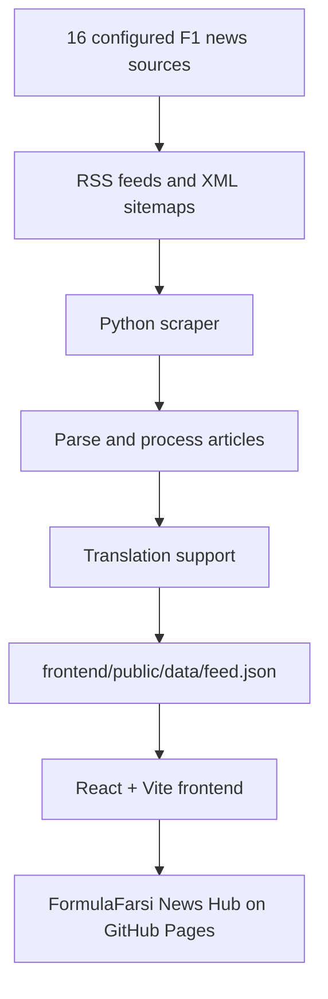

<div align="center">

# 🏎️ FormulaFarsi News Hub

### مرکز جامع اخبار فرمول یک

**All the latest Formula 1 news. One place. Multiple sources.**

[](https://rezakn82.github.io/f1-news-hub/)
[](https://t.me/formulafarsi)
[](https://github.com/rezakn82/f1-news-hub)

**FormulaFarsi News Hub** is a multi-source Formula 1 news aggregator developed for [FormulaFarsi](https://t.me/formulafarsi), an independent Persian-language Formula 1 media outlet.

</div>

---

## 📸 Preview

<p align="center">
  
</p>

---

## 🎯 About the Project

Keeping up with Formula 1 often means checking several news websites, languages, and publications throughout the day. **FormulaFarsi News Hub** brings articles from multiple international motorsport sources into one searchable and filterable news feed.

The project combines a Python-based news collection system with a React web interface. News sources are configured centrally, collected through available RSS feeds and XML sitemaps, processed by the scraper, and made available to the frontend through a JSON feed.

The interface is designed for following the latest F1 stories while making it easy to find news by publisher, language, topic, and date.

🔗 **Live website:** [rezakn82.github.io/f1-news-hub](https://rezakn82.github.io/f1-news-hub/)

📣 **Publisher:** [FormulaFarsi on Telegram](https://t.me/formulafarsi)

---

## ✨ Features

### 📰 Unified News Feed
- Aggregates Formula 1 news from **16 configured sources**.
- Brings Italian- and English-language publications together in one feed.
- Displays article headlines, summaries, publication times, source names, and available thumbnails.
- Provides direct links to the original publishers.

### 🔎 Search and Filtering
- Search articles by keywords, drivers, teams, and topics.
- Filter news by source and language.
- Browse articles by category.
- Narrow results by publication date.
- Sort the feed, including newest-first ordering.
- Use quick topic filters for frequently followed subjects and names.

### 🌍 Reading and Sharing Tools
- Persian-first interface with language controls.
- Translation and Persian-summary actions where available.
- Open the original article on its publisher's website.
- Copy, share, view, and bookmark news items using the available article controls.

### 🧭 News Categories
The interface groups stories into sections such as:
- All News
- Latest News
- Technical & Engineering
- Race Weekend
- Drivers
- Teams
- FIA & Regulations
- Transport, Partnerships & Sponsorships
- Saved News

### ⚙️ Additional Interface Features
- Light and dark appearance controls.
- Manual feed-refresh control.
- Feed update timestamp and current-time display.
- A source overview showing the configured publishers and their availability/status in the interface.

> Feature availability can depend on the source, the article, and the latest feed data. Some publishers may temporarily be unreachable or may change their feed structure.

---

## 🌐 Supported News Sources

The scraper currently defines **16 sources** in [`scraper/config.py`](scraper/config.py). The configured sources are listed below.

### 🇮🇹 Italian Sources — 5

| # | Source | Website | Primary language |
|---:|---|---|---|
| 1 | FormulaTecnica | [formulatecnica.it](https://www.formulatecnica.it/categoria/news-f1/) | Italian |
| 2 | FormulaPassion | [formulapassion.it](https://www.formulapassion.it/) | Italian |
| 3 | Sky Sport F1 IT | [sport.sky.it](https://sport.sky.it/formula-1) | Italian |
| 4 | Motorsport.com IT | [it.motorsport.com](https://it.motorsport.com/) | Italian |
| 5 | AutoRacer.it | [autoracer.it](https://autoracer.it/) | Italian |

### 🇬🇧 English Sources — 11

| # | Source | Website | Primary language |
|---:|---|---|---|
| 1 | Motorsport.com | [motorsport.com](https://www.motorsport.com/) | English |
| 2 | PlanetF1 | [planetf1.com](https://www.planetf1.com/) | English |
| 3 | F1Technical.net | [f1technical.net](https://www.f1technical.net/) | English |
| 4 | Formula1.com | [formula1.com](https://www.formula1.com/) | English |
| 5 | Autosport | [autosport.com](https://www.autosport.com/) | English |
| 6 | FIA – Formula One World Championship | [fia.com](https://www.fia.com/events/fia-formula-one-world-championship/season-2026/2026-fia-formula-one-world-championship) | English |
| 7 | RacingNews365 | [racingnews365.com](https://racingnews365.com/) | English |
| 8 | The Race | [the-race.com](https://www.the-race.com/formula-1/) | English |
| 9 | RaceFans | [racefans.net](https://www.racefans.net/category/formula-1/) | English |
| 10 | Pitpass | [pitpass.com](https://www.pitpass.com/) | English |
| 11 | F1-Insider | [f1-insider.com](https://f1-insider.com/en/) | English |

The source list is maintained in the scraper configuration. A source may use one or more RSS feed URLs, an XML sitemap, or both. The number of articles successfully collected can vary according to each publisher's availability and publishing format.

---

## 🧰 Technology Stack

### Frontend

| Technology | Purpose |
|---|---|
| [React 18](https://react.dev/) | User interface |
| [Vite](https://vite.dev/) | Development server and build tool |
| [Tailwind CSS 3](https://tailwindcss.com/) | Styling and responsive layout |
| [Lucide React](https://lucide.dev/) | Interface icons |

### Scraper and Data Processing

| Technology | Purpose |
|---|---|
| [Python](https://www.python.org/) | Scraper runtime |
| [HTTPX](https://www.python-httpx.org/) | HTTP requests |
| [feedparser](https://feedparser.readthedocs.io/) | RSS and Atom feed parsing |
| [Beautiful Soup 4](https://www.crummy.com/software/BeautifulSoup/bs4/doc/) | HTML parsing |
| [lxml](https://lxml.de/) | XML and HTML processing |
| [deep-translator](https://deep-translator.readthedocs.io/) | Translation support |
| [python-dateutil](https://dateutil.readthedocs.io/) | Date and time parsing |

### Automation and Hosting
- **GitHub Actions** — repository automation workflows.
- **GitHub Pages** — hosting for the web application.

---

## 🏗️ How It Works



The scraper's source definitions and feed output path are maintained in `scraper/config.py`. The generated feed is written to:

```text
frontend/public/data/feed.json
```

---

## 📂 Repository Structure

```text
f1-news-hub/
│
├── .github/
│   └── workflows/          # GitHub Actions workflows
│
├── frontend/               # React + Vite web application
│   └── public/
│       └── data/
│           └── feed.json   # Scraper output consumed by the frontend
│
├── scraper/                # Python news collection and processing
│   ├── config.py           # Source definitions and scraper settings
│   └── requirements.txt    # Python dependencies
│
└── README.md
```

---

## 🚀 Run Locally

### Prerequisites

- [Node.js](https://nodejs.org/) and npm
- Python 3.10 or newer
- Git

### 1. Clone the Repository

```bash
git clone https://github.com/rezakn82/f1-news-hub.git
cd f1-news-hub
```

### 2. Install and Run the Frontend

```bash
cd frontend
npm install
npm run dev
```

Open the local URL printed by Vite (by default, `http://localhost:5173`).

### 3. Build the Frontend

```bash
npm run build
```

To preview the production build locally:

```bash
npm run preview
```

### 4. Install Scraper Dependencies

Create and activate a Python virtual environment from the repository root:

**Windows (PowerShell):**

```powershell
python -m venv .venv
.venv\Scripts\Activate.ps1
```

**Linux / macOS:**

```bash
python3 -m venv .venv
source .venv/bin/activate
```

Install the scraper dependencies:

```bash
pip install -r scraper/requirements.txt
```

The source definitions and scraper settings are in `scraper/config.py`. Run the scraper using the runner script configured in the `scraper/` directory; `config.py` is the configuration module, not the execution command.

---

## 🛠️ Configuring News Sources

To manage the source list, edit `SOURCES_CONFIG` in [`scraper/config.py`](scraper/config.py).

Each source entry contains fields such as:

| Field | Description |
|---|---|
| `id` | Unique source identifier |
| `name` | Publisher name shown by the application |
| `url` | Main publisher or F1 news page |
| `language` | Source language (currently `en` or `it`) |
| `logo_text` | Short source label used in the interface |
| `accent_color` | Source-specific accent color |
| `default_category` | Default news category |
| `rss_urls` | RSS feed URL list |
| `sitemap_urls` | XML sitemap URL list |

Current scraper limits and settings defined in `config.py` include:

| Setting | Current value | Meaning |
|---|---:|---|
| `MAX_STORED_ARTICLES` | `500` | Maximum number of stored articles |
| `MAX_NEW_TRANSLATIONS_PER_RUN` | `25` | Maximum number of new translations per run |
| `REQUEST_TIMEOUT` | `15` seconds | HTTP request timeout |

When adding a publisher, check its feed or sitemap terms and make sure its content can be accessed and linked to appropriately.

---

## ⚖️ Copyright, License & Disclaimer

**Copyright © 2026 FormulaFarsi Media. All rights reserved.**

FormulaFarsi News Hub is developed for **[FormulaFarsi](https://t.me/formulafarsi)**, an independent Persian-language Formula 1 media outlet operating on Telegram.

This repository is public, but it is **not currently released under an open-source license**. Unless explicit written permission is granted by FormulaFarsi, copying, modifying, redistributing, republishing, or commercially using this project's source code, design, or branding is not permitted. No license such as MIT, Apache-2.0, or GPL is granted by making the repository publicly accessible.

### Third-Party Content

- FormulaFarsi News Hub is an independent fan-media project. It is not affiliated with, endorsed by, or officially connected to Formula 1, Formula One Management, the FIA, or any Formula 1 team.
- News articles, photographs, logos, trademarks, and other third-party materials remain the property of their respective owners and publishers.
- The project is intended to help users discover news and access the original publishers. Please use the original source links to read the publishers' articles and respect each website's terms of service, copyright notices, robots.txt policies, and feed usage conditions.
- Publisher names and logos are used only to identify the origin of the relevant news items.

For permission or other inquiries, contact FormulaFarsi through its [Telegram channel](https://t.me/formulafarsi).

---

## 🏁 About FormulaFarsi

**FormulaFarsi** is a Persian-language Formula 1 media outlet sharing F1 news and content with Persian-speaking fans.

- **Telegram:** [t.me/formulafarsi](https://t.me/formulafarsi)
- **Instagram:** [FormulaFarsi](https://www.instagram.com/formulafarsi/?hl=en)
- **News Hub:** [rezakn82.github.io/f1-news-hub](https://rezakn82.github.io/f1-news-hub/)
- **GitHub Repository:** [github.com/rezakn82/f1-news-hub](https://github.com/rezakn82/f1-news-hub)

<div align="center">

**Made for Formula 1 fans, by FormulaFarsi Team. 🏁**

</div>
